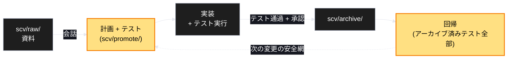
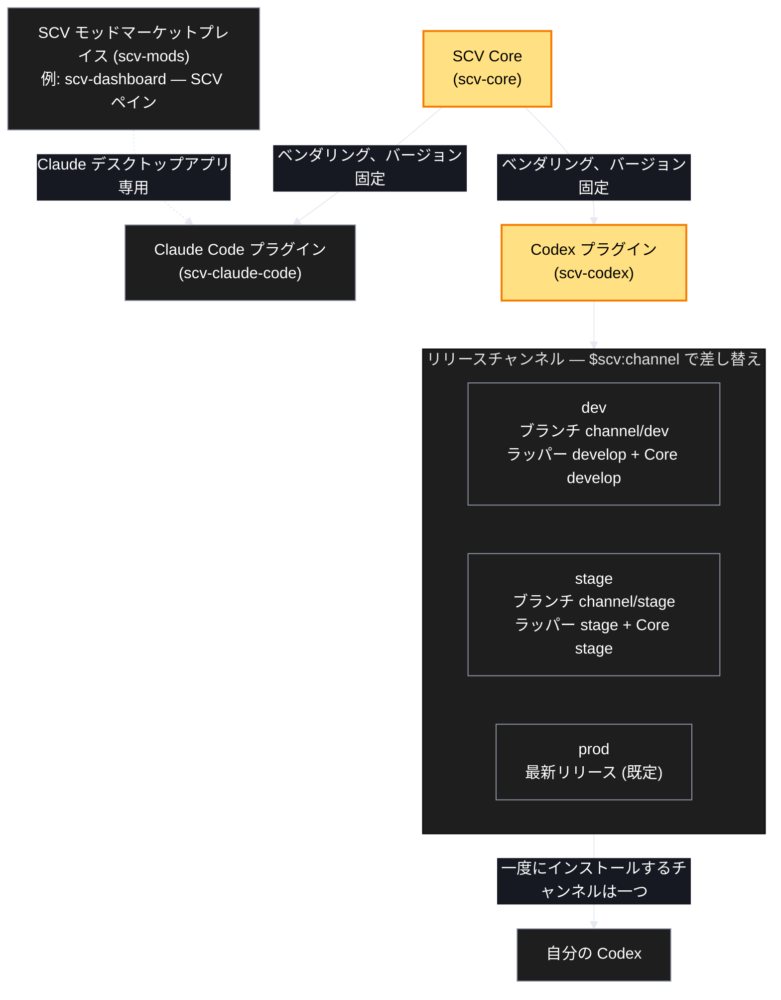

<div align="center">


# SCV for Codex

**Standard · Cowork · Verify**

**チームのための Codex プラグイン。すべての変更は計画とテストとともに出荷され —
テストは永遠に回り続けます。**

[Latest release](https://github.com/wookiya1364/scv-codex/releases/latest) ·
[English](./README.md) · [한국어](./README.ko.md)

</div>

---

## SCV とは

変更の話をする → SCV が実行可能なテストつきの計画へ磨き上げる → 実装する →
証跡を PR/MR に添付する → 計画をアーカイブする。アーカイブされたテストは
すべて回帰スイートに蓄積され、以後のあらゆる変更を検査します。

## インストール

```bash
codex plugin marketplace add https://github.com/wookiya1364/scv-codex.git
codex plugin add scv@scv-codex
```

インストールしたスキルが読み込まれるよう、新しい Codex セッションを開始して
ください。

- **macOS**: `brew install bash` を一度 (bash 4+)。**Linux / WSL**: 何も不要。
- 推奨 CLI: `git`, `curl`, `jq`, `gh` (または `glab`)。

**更新**したら、新しいセッションを開始してください:

```bash
codex plugin marketplace upgrade scv-codex
codex plugin add scv@scv-codex
```

すると各プロジェクトは、そのセッションの最初のアクションで SCV のファイルを
自ら更新し、更新したことを伝えます。

## 使い方

**普通に話しかけるだけ。** SCV は既定で会話に加わります:

```text
あなた: SCV で — 決済画面に払い戻しボタンを付けたい。
SCV:    (会話モードに入り、目標 / 範囲 / 受け入れ基準を質問し、
         十分になったら計画とテストの下書きを提案)
```

作りたいことを話せば計画に磨き上げ、次にすべきことを聞けばリポジトリを診断し、
過去の作業を聞けばタイトルだけでなく計画の本文、テスト、決定、会話まで探します。
`$scv:help` は明示的なセレクター、`scv/scv_settings.json` の
`SCV_ALWAYS_ON=off` でコマンド専用に戻せます。(`/scv:<name>` は Claude Code
の表記 — ここでは使いません。)

SCV は毎ターン、次のことも行います:

- **やさしい言葉で答えます** — 一、二文の結論が先、次に例を一つ、コードの値は
  聞かれたときだけ (`SCV_PLAIN_LANGUAGE`);
- **モデルの提供元が勧めるやり方でモデルに依頼します** — GPT と Codex モデル向けの
  OpenAI 公式プロンプティングガイドを同梱し、依頼を実行中のモデルの要求項目と
  一つずつ照合して、書き直した依頼を結論のすぐ後に引用します
  (`SCV_MODEL_PROMPTING`);
- **実物を動かして見せます** — 成果物が変わるターンでは、最初に動く瞬間に最小の
  ものを実際に実行し、その結果 (コマンド出力 · 画面 · 関数の結果) をそのまま見せ、
  続けるか直すかを一度聞きます。何も変わらなければ「成果物の変化なし」と書き、
  何も聞きません (`SCV_SHOW_REAL`)。

Codex では動かないもの: **再開サマリー** (`SCV_RESUME_RECAP`)。Claude Code ではセッション
開始フックが `/clear`、圧縮、再開のあとに進行中の計画と最近の決定を載せ直します。Codex には
セッション開始フックがないため — このプラグインが登録するのは `PreToolUse`、`UserPromptSubmit`、
`Stop` だけです — 再開サマリーはここでは動かず、この設定も効果がありません。

すべての会話の裏のループ: 資料 → 計画 + テスト → 実装 → アーカイブ → 回帰。
アーカイブは墓場ではありません — 長く使うほど安全網が厚くなります。



## 得られるもの

| チームの問題 | SCV の答え |
|---|---|
| AI の diff を信じる前に自分で動かしている | 合意済みテストがゲートとして回り、e2e 証跡が実際の実行記録に基づいて PR/MR に付く |
| 同じ変更がチケット · PR · チャットで違って書かれる | `PLAN.md` が単一の原本; チケットは `refs:` リンク |
| 決定がセッションとともに消える | `scv/DECISIONS.md` — 追記専用、自動記録、教訓も一緒に |
| 古い機能が音もなく壊れる | アーカイブされた全計画のテストがひとつのスイートで再実行 |
| 計画書が文字の壁になる | `$scv:deck` が計画の図の文書 (`FEATURE_ARCHITECTURE.md`) を番号付き画面設計書として描く |
| 変更がどこまで及ぶかわからない | 文書 · 計画 · 一緒に変わるファイルをつなぐ SCV 独自のグラフ (`SCV_GRAPH`); Graft が入っていればコード候補も (`SCV_GRAFT`) |
| 「これ、前に試した?」 | 過去の作業の検索が計画本文、テスト、決定、会話まで読む — [過去の作業の検索](plugins/scv/vendor/scv-core/core/protocols/help/archive-search.md) を参照 |
| プロセスがうまく回っているかわからない | `metrics.sh` がプロジェクトの記録をプロセスの数字にして見せる — 読むだけ |

## 設定

ファイルはひとつ: `scv/scv_settings.json` — 全キーが説明つきで自動生成されます。
秘密は git-ignore される別ファイルへ。`.env` は読みも書きもしません。

| キー | 既定 | 役割 |
|---|---|---|
| `SCV_ALWAYS_ON` | `on` | 自由会話にも SCV; `off` = 明示的スキルのみ |
| `SCV_PLAIN_LANGUAGE` | `on` | やさしい言葉優先; `off` で停止 |
| `SCV_MODEL_PROMPTING` | `on` | モデル別プロンプティング: モデルのガイドを読み、毎回の依頼を照合 · 登録 |
| `SCV_SHOW_REAL` | `on` | 成果物が変わると最小のものを実際に動かして結果を見せる; `off` で止める |
| `SCV_RESUME_RECAP` | `on` | Codex では効果なし (セッション開始フックがない) |
| `SCV_LANG` | 自動 | `english` · `korean` · `japanese` |
| `NOTIFIER_PROVIDER` | オフ | `slack` か `discord` |

その他のキーと既定値:
[`scv_settings.example.json`](plugins/scv/vendor/scv-core/core/template/scv/scv_settings.example.json)。

```bash
bash plugins/scv/vendor/scv-core/core/scripts/settings-set.sh SCV_LANG=japanese
bash plugins/scv/vendor/scv-core/core/scripts/metrics.sh      # プロセスの数字
```

## スキル

会話が自動でルーティングします; 明示的なセレクター:

| スキル | 役割 |
|---|---|
| `$scv:help` | 診断 · アイデアの具体化 · 過去の作業の検索 |
| `$scv:status` | 進行中のもの |
| `$scv:promote` | 資料 → 計画 + テスト + 図 |
| `$scv:work <slug>` | 実装 · テスト · アーカイブ · 証跡つき PR/MR |
| `$scv:codegen <slug>` | TDD-first 変種 (テストがコードを導く) |
| `$scv:regression` | アーカイブされた全計画のテストを実行 |
| `$scv:deck [<md>]` | 計画 → 番号付き画面設計書 (Markdown → 企画書ドキュメント / スライドも) |
| `$scv:report` | フェーズ結果を Slack/Discord へ |
| `$scv:sync` | テンプレート更新 + ドリフト検知 |
| `$scv:routine <name>` | 1 ファイルのメンテナンスルーチン |
| `$scv:dreams` | 過去のセッションを振り返り、より良いプロンプトを助言 |
| `$scv:mods` · `$scv:mods-install` · `$scv:mods-remove` | SCV モッドは Claude デスクトップアプリのプラグイン — Codex は一行で案内 |
| `$scv:channel` | SCV を開発 · ステージング · 本番チャネルに切り替え — リリース前に新しい作業を確認 |
| `$scv:workspace` · `$scv:handoff` | マルチレポのアンブレラ · 他リポジトリ作業の宣言 |
| `$scv:update` · `$scv:set-models` · `$scv:install-deps` | 更新案内 · モデルポリシー診断 · CLI 依存 |

`$scv:set-models` はこのホストでは読み取り専用です: Codex スキルはスキル別の
モデル固定ができないため、旧ポリシーの意図を診断するのみで、
`.codex/config.toml` の編集は明示的な依頼 · プレビュー · 確認を経たときだけ
行います。

## ガードレール

- **セッション内**: `PreToolUse` ガードが、手作りの計画ファイルと `scv/` 外への
  書き込みをレシートが生まれるまで拒否します — ここではベンダースクリプトを
  呼ぶシェル呼び出しがレシートを発行します (Codex にはスキル呼び出しイベントが
  ないため、Claude Code ラッパーより意図的に弱い設計です)。内部エラー時は開く
  側へ; SCV 未導入リポジトリでは不活性; `SCV_GUARD=off` で停止。
- **マージ時**: CI ゲートが、アーカイブ済み計画のないコード変更を拒否し
  (`[no-plan: <理由>]`)、宣言のないベンダー書き換えを拒否します
  (`[manual-vendor: <理由>]`)。

Codex のフックはホットリロードされません: プラグイン更新後は Codex を再起動し、
変わったフックは `/hooks` で再承認してください。契約:
[`core/contracts/guard.md`](plugins/scv/vendor/scv-core/core/contracts/guard.md)。

## マルチレポ

`$scv:workspace` が FE/BE/サービスのリポジトリをアンブレラひとつに束ねるか
参加させ、`$scv:handoff` が他リポジトリの作業を相手が見る場所に宣言します。
リンクを外せば単独動作に復帰。モジュール別 `scv/` を持つモノレポは先頭引数で
モジュール指定: `$scv:status FE`。

## 共有コアとリリース

動作は [scv-core](https://github.com/wookiya1364/scv-core) にあり、
`plugins/scv/vendor/scv-core/` 配下にチェックサムつきでベンダリングされます —
実行時に何も取得しません。プロンプティングガイドは `plugins/scv/prompting/`
以下に OpenAI 公式ガイドの原文そのままで置かれ、要求項目の引用が原文に一字一句
あるかを CI が検査します。ラッパー・コア・テンプレートのバージョンは独立に
動き、コアロックが原本・アーティファクトのハッシュを記録します。同期ボットが
`chore/core-*` PR でピン更新を提案し、リリースは `develop → stage → main` を
`gh workflow run promote.yml` で歩きます — [docs/RELEASING.md](docs/RELEASING.md)。

部品のつながり — Core はホストごとのプラグインにベンダリングされ、チャンネルが
インストールするビルドを選び、モッドは Claude デスクトップアプリ専用のプラグインです:



## 出自とライセンス

SCV for Codex と
[SCV for Claude Code](https://github.com/wookiya1364/scv-claude-code) は、同じ
SCV Core の上の薄いホストアダプターです。

MIT © [wookiya1364](https://github.com/wookiya1364)
