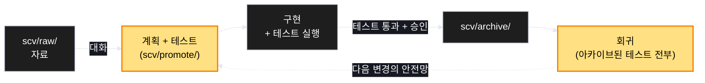
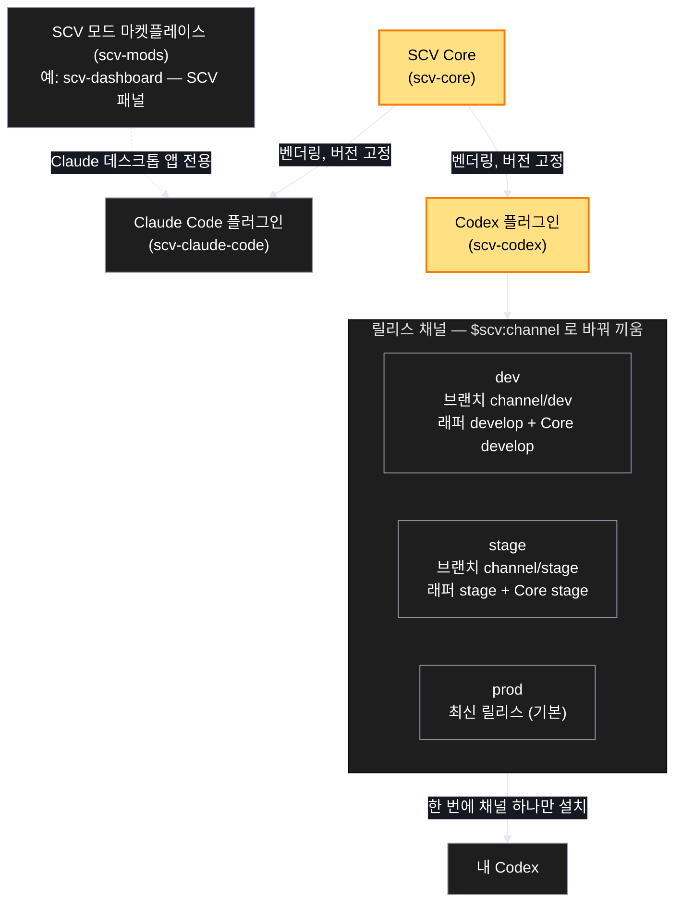

<div align="center">


# SCV for Codex

**Standard · Cowork · Verify**

**팀을 위한 Codex 플러그인. 모든 변경은 계획과 테스트와 함께 나가고 —
테스트는 영원히 돕니다.**

[Latest release](https://github.com/wookiya1364/scv-codex/releases/latest) ·
[English](./README.md) · [日本語](./README.ja.md)

</div>

---

## SCV가 뭔가요

변경 얘기를 꺼내면 → SCV가 실행 가능한 테스트가 딸린 계획으로 다듬고 →
구현하고 → 증적을 PR/MR에 붙이고 → 계획을 아카이브합니다. 아카이브된
테스트는 전부 회귀 스위트에 쌓여 이후 모든 변경을 검사합니다.

## 설치

```bash
codex plugin marketplace add https://github.com/wookiya1364/scv-codex.git
codex plugin add scv@scv-codex
```

설치된 스킬이 로드되도록 새 Codex 세션을 시작하세요.

- **macOS**: `brew install bash` 한 번 (bash 4+). **Linux / WSL**: 할 것 없음.
- 권장 CLI: `git`, `curl`, `jq`, `gh` (또는 `glab`).

**업데이트**하고 나서 새 세션을 시작하세요:

```bash
codex plugin marketplace upgrade scv-codex
codex plugin add scv@scv-codex
```

그러면 각 프로젝트가 그 세션의 첫 액션에서 SCV 파일을 스스로 갱신하고, 갱신했다고
말해 줍니다.

## 쓰는 법

**그냥 말 걸면 됩니다.** SCV가 기본으로 대화에 끼어듭니다:

```text
나:   SCV로 — 결제 화면에 환불 버튼 넣고 싶어.
SCV:  (대화 모드 진입 — 목표 / 범위 / 인수 기준을 묻고,
       충분해지면 계획과 테스트 초안을 제안)
```

만들고 싶은 걸 말하면 계획으로 다듬고, 다음 할 일을 물으면 저장소를 진단하고,
과거 작업을 물으면 제목만이 아니라 계획 본문, 테스트, 결정, 대화까지 찾습니다.
`$scv:help`는 명시적 선택자이고, `scv/scv_settings.json`의 `SCV_ALWAYS_ON=off`가
명령 전용으로 되돌립니다. (`/scv:<name>`은 Claude Code 표기 — 여기서는 안 씁니다.)

SCV는 매 턴 이런 일도 합니다:

- **쉬운 말로 답합니다** — 한두 문장의 결론이 먼저, 그다음 예시 하나, 코드 값은
  물어볼 때만 (`SCV_PLAIN_LANGUAGE`);
- **모델 회사가 권하는 방식으로 모델에 요청합니다** — GPT 와 Codex 모델용 OpenAI
  공식 프롬프팅 가이드를 싣고, 요청을 지금 모델의 가이드가 말하는 대로 다시
  써서 답 맨 위에 인용합니다 (`SCV_MODEL_PROMPTING`);
- **실제로 돌려 보여 줍니다** — 결과물이 바뀌는 턴이면 처음 돌아가는 순간 가장
  작은 것을 실제로 실행해 그 결과(명령 출력 · 화면 · 함수 결과)를 그대로 보이고,
  계속할지 고칠지를 한 번 묻습니다. 바뀌는 것이 없으면 "결과물 변화 없음"이라고
  적고 묻지 않습니다 (`SCV_SHOW_REAL`).

Codex에서는 안 되는 것: **재개 요약** (`SCV_RESUME_RECAP`). Claude Code에서는 세션 시작
훅이 `/clear`, 압축, 재개 뒤에 진행 중인 계획과 최근 결정을 다시 실어 줍니다. Codex에는
세션 시작 훅이 없어서 — 이 플러그인은 `PreToolUse`, `UserPromptSubmit`, `Stop`만 등록합니다
— 재개 요약이 여기서는 돌지 않고, 이 설정도 효과가 없습니다.

모든 대화 뒤의 루프: 자료 → 계획 + 테스트 → 구현 → 아카이브 → 회귀.
아카이브는 무덤이 아닙니다 — 오래 쓸수록 안전망이 두꺼워집니다.



## 얻는 것

| 팀의 문제 | SCV가 하는 일 | 어디서 |
|---|---|---|
| AI 변경을 직접 돌려 봐야 믿는다 | PR에 테스트 영상이 붙는다 | `$scv:work` |
| 티켓 · PR · 채팅 설명이 제각각 | 계획서 하나에서 PR · 보고를 만든다 | `PLAN.md` |
| 결정이 세션과 함께 사라진다 | 결정 기록에 자동으로 남는다 | `scv/DECISIONS.md` |
| 옛 기능이 소리 없이 깨진다 | 지난 계획의 테스트를 다시 돌린다 | `$scv:regression` |
| 계획서가 글자 벽이다 | 번호 붙은 그림 한 장 | `$scv:deck` · `FEATURE_ARCHITECTURE.md` |
| 어디까지 닿을지 모른다 | 함께 바뀌는 파일을 보인다 | `SCV_GRAPH` · `SCV_GRAFT` |
| "이거 전에 해 봤나?" | 지난 계획 · 대화까지 찾는다 | [지난 작업 찾기](plugins/scv/vendor/scv-core/core/protocols/help/archive-search.md) |
| 같은 함수를 또 만든다 | 함수 사전에서 먼저 찾는다 | [순수함수 사전](plugins/scv/vendor/scv-core/core/contracts/purity.md) |
| 과정이 잘 도는지 모른다 | 기록을 숫자로 보여 준다 | `metrics.sh` |

## 설정

파일 하나: `scv/scv_settings.json` — 모든 키가 설명과 함께 자동 생성됩니다.
비밀은 git 무시되는 별도 파일로. `.env`는 읽지도 쓰지도 않습니다.

| 키 | 기본 | 하는 일 |
|---|---|---|
| `SCV_ALWAYS_ON` | `on` | 일반 대화에도 SCV; `off` = 명시적 스킬만 |
| `SCV_PLAIN_LANGUAGE` | `on` | 쉬운말 우선; `off`로 끔 |
| `SCV_MODEL_PROMPTING` | `on` | 모델별 프롬프팅 (아래 참고) |
| `SCV_SHOW_REAL` | `on` | 바뀌면 실물을 돌려 보임; `off`면 끔 |
| `SCV_RESUME_RECAP` | `on` | Codex에서는 효과 없음 (세션 시작 훅이 없음) |
| `SCV_LANG` | 자동 | `english` · `korean` · `japanese` |
| `NOTIFIER_PROVIDER` | 꺼짐 | `slack` 또는 `discord` |

`SCV_MODEL_PROMPTING`은 모델의 가이드를 읽고 매 요청을 비교 · 등록합니다.
`SCV_SHOW_REAL`은 결과물이 바뀌면 가장 작은 것을 실제로 돌려 결과를 보입니다.

나머지 키와 기본값:
[`scv_settings.example.json`](plugins/scv/vendor/scv-core/core/template/scv/scv_settings.example.json).

```bash
bash plugins/scv/vendor/scv-core/core/scripts/settings-set.sh SCV_LANG=korean
bash plugins/scv/vendor/scv-core/core/scripts/metrics.sh      # 과정 숫자
```

## 스킬

대화가 알아서 라우팅합니다; 명시적 선택자:

| 스킬 | 하는 일 |
|---|---|
| `$scv:help` | 진단 · 아이디어 다듬기 · 지난 작업 찾기 |
| `$scv:status` | 진행 중인 것 |
| `$scv:promote` | 자료 → 계획 + 테스트 + 다이어그램 |
| `$scv:work <slug>` | 구현 · 테스트 · 아카이브 · 증적 붙은 PR/MR |
| `$scv:codegen <slug>` | TDD-first 변형 (테스트가 코드를 이끈다) |
| `$scv:regression` | 아카이브된 모든 계획의 테스트 실행 |
| `$scv:deck [<md>]` | 계획 → 화면설계서 (md → 기획서 / 슬라이드) |
| `$scv:report` | 페이즈 결과를 Slack/Discord로 |
| `$scv:sync` | 템플릿 갱신 + 드리프트 감지 |
| `$scv:routine <name>` | 파일 하나짜리 유지보수 루틴 |
| `$scv:dreams` | 지난 세션을 돌아보며 더 좋은 프롬프트 코칭 |
| `$scv:mods` · `$scv:mods-install` · `$scv:mods-remove` | 데스크톱 앱 전용 플러그인 — Codex 는 한 줄 안내 |
| `$scv:channel` | 개발 · 스테이징 · 운영 전환 — 릴리스 전 새 작업 확인 |
| `$scv:workspace` · `$scv:handoff` | 멀티레포 우산 · 타 저장소 작업 선언 |
| `$scv:update` · `$scv:set-models` · `$scv:install-deps` | 업데이트 안내 · 모델 정책 진단 · CLI 의존성 |

`$scv:deck`은 번호식 화면설계서를 씁니다. SCV 모드는 Claude 데스크톱 앱 플러그인입니다.

`$scv:set-models`는 이 호스트에서 읽기 전용입니다: Codex 스킬은 스킬별 모델
고정이 안 되므로, 과거 정책의 의도를 진단만 하고 `.codex/config.toml` 수정은
명시적 요청 · 미리보기 · 확인을 거칠 때만 합니다.

## 가드레일

- **세션 안**: `PreToolUse` 가드가 손으로 만든 계획 파일과 `scv/` 밖 쓰기를
  영수증이 생기기 전까지 거부합니다 — 여기서는 벤더 스크립트를 부르는 셸
  호출이 영수증을 발급합니다 (Codex에는 스킬 호출 이벤트가 없어 Claude Code
  래퍼보다 의도적으로 약합니다). 내부 오류에는 열리는 쪽으로; SCV 미도입
  저장소에서는 무반응; `SCV_GUARD=off`로 끔.
- **머지 시점**: CI 게이트가 아카이브된 계획 없는 코드 변경을 거부하고
  (`[no-plan: <이유>]`), 선언 없는 벤더 재작성을 거부합니다
  (`[manual-vendor: <이유>]`).

Codex 훅은 핫리로드가 안 됩니다: 플러그인 업데이트 후 Codex를 재시작하고,
바뀐 훅은 `/hooks`로 다시 승인하세요. 계약:
[`core/contracts/guard.md`](plugins/scv/vendor/scv-core/core/contracts/guard.md).

## 멀티레포

`$scv:workspace`가 FE/BE/서비스 저장소를 우산 하나로 묶거나 합류시키고,
`$scv:handoff`가 타 저장소 작업을 상대가 보게 될 곳에 선언합니다. 연결을
끊으면 단독 동작으로 복귀. 모듈별 `scv/`를 둔 모노레포는 선행 인자로 모듈
지정: `$scv:status FE`.

## 공유 코어와 릴리스

동작은 [scv-core](https://github.com/wookiya1364/scv-core)에 삽니다:

- `plugins/scv/vendor/scv-core/` 아래 체크섬과 함께 벤더링됩니다 — 런타임에
  아무것도 내려받지 않습니다.
- 프롬프팅 가이드는 `plugins/scv/prompting/` 아래 OpenAI 공식 가이드 원문
  그대로 있고, 사본마다 출처 · 날짜 · 저작권 줄이 있는지 CI가 검사합니다.
- 래퍼·코어·템플릿 버전은 독립적으로 움직이고, 코어 락이 원본·아티팩트
  해시를 기록합니다.
- 싱크 봇이 `chore/core-*` PR로 핀 갱신을 제안합니다.
- 릴리스는 `develop → stage → main`을 `gh workflow run promote.yml`로
  걷습니다 — [docs/RELEASING.md](docs/RELEASING.md).

조각들이 맞물리는 모양 — Core는 호스트마다의 플러그인에 벤더링되고, 채널이 설치할
빌드를 고르며, 모드는 Claude 데스크톱 앱 전용 플러그인입니다:



## 출처와 라이선스

SCV for Codex와
[SCV for Claude Code](https://github.com/wookiya1364/scv-claude-code)는 같은
SCV Core 위의 얇은 호스트 어댑터입니다.

MIT © [wookiya1364](https://github.com/wookiya1364)
