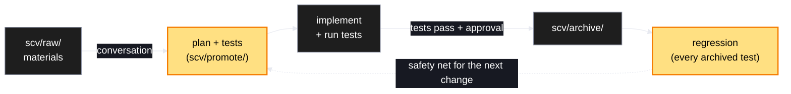
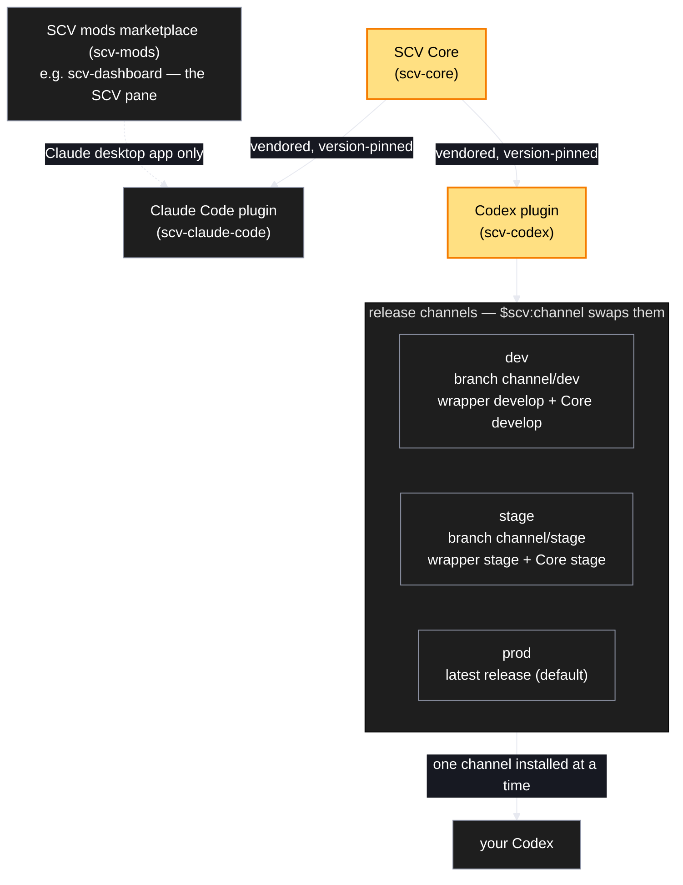

<div align="center">


# SCV for Codex

**Standard · Cowork · Verify**

**A Codex plugin for teams. Every change ships with a plan and tests — and
the tests run forever.**

[Latest release](https://github.com/wookiya1364/scv-codex/releases/latest) ·
[한국어](./README.ko.md) · [日本語](./README.ja.md)

</div>

---

## What is SCV

Talk about a change → SCV refines it into a plan with executable tests →
implements it → attaches the evidence to the PR/MR → archives the plan. Every
archived test joins a regression suite that runs against every future change.

## Install

```bash
codex plugin marketplace add https://github.com/wookiya1364/scv-codex.git
codex plugin add scv@scv-codex
```

Start a new Codex session so the installed skills load.

- **macOS**: `brew install bash` once (bash 4+). **Linux / WSL**: nothing to do.
- Recommended CLIs: `git`, `curl`, `jq`, `gh` (or `glab`).

**Update** to the latest release, then start a new session:

```bash
codex plugin marketplace upgrade scv-codex
codex plugin add scv@scv-codex
```

Each project then refreshes its SCV files on the first action of that session
— and says so.

## How you use it

**Just talk.** SCV joins the conversation by default:

```text
You:  Use SCV — I want to add a refund button to checkout.
SCV:  (enters conversation mode, asks goal / scope / acceptance,
       then offers to draft the plan and tests)
```

Describe what you want and SCV refines it into a plan; ask what to do next and
it diagnoses the repository; ask about past work and it searches plan bodies,
tests, decisions, and conversations, not only titles. `$scv:help` is the
explicit selector when you want it, and `SCV_ALWAYS_ON=off` in
`scv/scv_settings.json` restores command-only behavior. (`/scv:<name>` is the
Claude Code spelling — not used here.)

Every turn, SCV also:

- **answers in plain language** — a one- or two-sentence conclusion first,
  then one example, code values only when you ask (`SCV_PLAIN_LANGUAGE`);
- **prompts your model the way its vendor recommends** — SCV ships OpenAI's
  official prompting guides for the GPT and Codex models, rewrites each
  request the way the running model's guide says, and quotes the
  rewritten request at the top of the answer (`SCV_MODEL_PROMPTING`);
- **shows the real thing** — when a turn changes the deliverable, at the first
  moment it runs SCV runs the smallest real thing, shows its actual output
  (command output, screen, function result), and asks once whether to continue
  or fix; when nothing changes it writes "no change to the deliverable" and asks
  nothing (`SCV_SHOW_REAL`).

Not on Codex: **resume recap** (`SCV_RESUME_RECAP`). On Claude Code a
session-start hook re-injects active plans and recent decisions after `/clear`,
compaction, or a resume. Codex has no session-start hook — this plugin
registers only `PreToolUse`, `UserPromptSubmit`, and `Stop` — so the recap does
not run here and the setting has no effect.

The loop behind every conversation: materials → plan + tests → implement →
archive → regression. The archive is not a graveyard — the longer the team
uses SCV, the thicker the safety net.



## What you get

| Team problem | What SCV does | Where |
|---|---|---|
| You run an AI diff before trusting it | The PR arrives with a test video | `$scv:work` |
| Ticket · PR · chat tell it differently | One plan feeds the PR and reports | `PLAN.md` |
| Decisions vanish with the session | They land in a decision log | `scv/DECISIONS.md` |
| Old features silently break | Past plans' tests run again | `$scv:regression` |
| Plans read as a wall of text | One numbered picture per plan | `$scv:deck` · `FEATURE_ARCHITECTURE.md` |
| Unclear what a change will touch | Shows files that change together | `SCV_GRAPH` · `SCV_GRAFT` |
| "Did we already try this?" | Searches past plans and talks | [archive search](plugins/scv/vendor/scv-core/core/protocols/help/archive-search.md) |
| The same helper gets rewritten | Checks the function catalog first | [pure-function catalog](plugins/scv/vendor/scv-core/core/contracts/purity.md) |
| No idea if the process works | Turns records into numbers | `metrics.sh` |

## Settings

One file: `scv/scv_settings.json` — auto-created with every key documented.
Secrets go to a separate git-ignored file. `.env` is never read or written.

| Key | Default | What it does |
|---|---|---|
| `SCV_ALWAYS_ON` | `on` | SCV joins free conversation; `off` = explicit skills only |
| `SCV_PLAIN_LANGUAGE` | `on` | plain-first answers; `off` silences |
| `SCV_MODEL_PROMPTING` | `on` | per-model prompting (see below) |
| `SCV_SHOW_REAL` | `on` | show a real run on change; `off` silences |
| `SCV_RESUME_RECAP` | `on` | no effect on Codex (no session-start hook) |
| `SCV_LANG` | auto | `english` · `korean` · `japanese` |
| `NOTIFIER_PROVIDER` | off | `slack` or `discord` |

`SCV_MODEL_PROMPTING` reads the model's guide, then compares and registers every request.
`SCV_SHOW_REAL` runs the smallest real thing and shows its output when the deliverable changes.

Every other key and its default:
[`scv_settings.example.json`](plugins/scv/vendor/scv-core/core/template/scv/scv_settings.example.json).

```bash
bash plugins/scv/vendor/scv-core/core/scripts/settings-set.sh SCV_LANG=korean
bash plugins/scv/vendor/scv-core/core/scripts/metrics.sh      # process numbers
```

## Skills

Conversation routes for you; the explicit selectors:

| Skill | Does |
|---|---|
| `$scv:help` | Diagnose · refine an idea · search past work |
| `$scv:status` | What's in flight |
| `$scv:promote` | Materials → plan + tests + diagrams |
| `$scv:work <slug>` | Implement · test · archive · PR/MR with evidence |
| `$scv:codegen <slug>` | TDD-first variant (tests drive the code) |
| `$scv:regression` | Run every archived plan's tests |
| `$scv:deck [<md>]` | Plan → screen spec (md → planning doc / slides) |
| `$scv:report` | Phase result to Slack/Discord |
| `$scv:sync` | Refresh templates + drift detection |
| `$scv:routine <name>` | One-file maintenance routines |
| `$scv:dreams` | Look back at past sessions · coach better prompts |
| `$scv:mods` · `$scv:mods-install` · `$scv:mods-remove` | Desktop-app plugins only — Codex says so in one line |
| `$scv:channel` | Swap dev · stage · prod — try new work before a release |
| `$scv:workspace` · `$scv:handoff` | Multi-repo umbrella · cross-repo declaration |
| `$scv:update` · `$scv:set-models` · `$scv:install-deps` | Update guide · model-policy diagnostic · CLI deps |

`$scv:deck` writes a numbered screen spec. SCV mods are Claude desktop-app plugins.

`$scv:set-models` is read-only on this host: Codex skills cannot pin per-skill
models, so it diagnoses legacy policy intent and only edits
`.codex/config.toml` after explicit request, preview, and confirmation.

## Guardrails

- **In-session**: a `PreToolUse` guard refuses hand-created plan files and
  writes outside `scv/` until a receipt exists — here minted by a shell call
  into the vendored scripts (Codex has no skill-invocation event, so this is
  deliberately weaker than the Claude Code wrapper). Fails open on internal
  error; inert where SCV isn't adopted; `SCV_GUARD=off` disables.
- **At merge**: CI gates require an archived plan for code changes
  (`[no-plan: <reason>]` declares an exception) and declared vendor rewrites
  (`[manual-vendor: <reason>]`).

Codex hooks are not hot-reloaded: restart Codex after updating the plugin, and
re-approve changed hooks via `/hooks`. Contract:
[`core/contracts/guard.md`](plugins/scv/vendor/scv-core/core/contracts/guard.md).

## Multi-repo

`$scv:workspace` creates/joins an umbrella across FE/BE/service repos;
`$scv:handoff` declares cross-repo work where the other repo will see it.
Detaching restores standalone behavior. Monorepos with per-module `scv/`
target a module by leading argument: `$scv:status FE`.

## Shared core and releases

Behavior lives in [scv-core](https://github.com/wookiya1364/scv-core):

- Vendored checksummed under `plugins/scv/vendor/scv-core/` — nothing fetched
  at runtime.
- The prompting guides live under `plugins/scv/prompting/` as verbatim copies
  of OpenAI's official guides; CI checks that each copy carries its source,
  date and copyright lines.
- Wrapper, core, and template versions move independently; the core lock
  records source and artifact hashes.
- A sync bot proposes pin updates as `chore/core-*` PRs.
- Releases walk `develop → stage → main` via `gh workflow run promote.yml` —
  see [docs/RELEASING.md](docs/RELEASING.md).

How the pieces fit — Core is vendored into each host's plugin, the channel
picks which build you install, and mods are Claude desktop-app plugins only:



## Origin and license

SCV for Codex and
[SCV for Claude Code](https://github.com/wookiya1364/scv-claude-code) are thin
host adapters over the same SCV Core.

MIT © [wookiya1364](https://github.com/wookiya1364)
